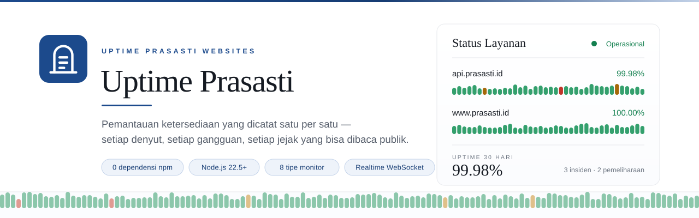

<div align="center">
  
</div>

<div align="center">

        

</div>

<p align="center">
  <strong>Uptime Prasasti Websites</strong> — pemantauan ketersediaan situs dan layanan yang direkam satu per satu seperti prasasti:
  setiap denyut disimpan, setiap gangguan tercatat, dan setiap status page punya jejak yang bisa dibaca publik.
</p>

---

## Daftar Isi

<table>
<tr>
  <td align="left" width="50%">

- [Ringkasan](#ringkasan)
- [Fitur](#fitur)
- [Mulai Cepat](#mulai-cepat)
- [Tipe Monitor](#tipe-monitor)
- [Notifikasi](#notifikasi)
- [Status Page & Badge](#status-page--badge)

</td>
<td align="left" width="50%">

- [Realtime](#realtime)
- [Arsitektur](#arsitektur)
- [Konfigurasi](#konfigurasi-lingkungan)
- [REST API](#rest-api)
- [Penyimpanan & Retensi](#penyimpanan--retensi)
- [Keamanan](#keamanan)
- [Pengujian](#pengujian)
- [Deployment](#deployment)
- [Kontribusi](#kontribusi)
- [Lisensi](#lisensi)

</td>
</tr>
</table>

---

## Ringkasan

| Aspek | Keterangan |
| --- | --- |
| **Runtime** | Node.js ≥ 22.5 (`node:sqlite`), diuji pada Node.js 24. |
| **Dependensi** | Nol. Hanya modul bawaan Node.js dan WebSocket yang ditulis sendiri. |
| **Build step** | Tidak ada bundler, tidak ada `npm install`, tidak ada kompilasi. |
| **Basis data** | SQLite mode WAL, satu berkas di `data/prasasti.db`. |
| **Antarmuka** | Dasbor admin + status page publik, ditulis sebagai modul ES tanpa framework. |
| **Realtime** | WebSocket di `/ws`, ditulis di atas `node:http` + `node:crypto`. |
| **Pengujian** | 41 uji integrasi, dijalankan tanpa dependensi pengujian. |

## Fitur

| Fitur | Rincian |
| --- | --- |
| **Delapan tipe monitor** | HTTP(S), kata kunci, JSON, TCP, ICMP ping, DNS, push, dan grup. |
| **Denyut & grafik** | Riwayat heartbeat dengan bar 24 jam, grafik waktu respons, uptime 24 jam/7/30/365 hari, log kejadian per monitor. |
| **Status page publik** | Halaman mandiri di `/status/<slug>` dengan grup monitor, uptime, riwayat insiden, jadwal pemeliharaan, dan pembaruan realtime. |
| **Insiden otomatis** | Gangguan membuka insiden pada setiap status page yang memuat monitor tersebut, lalu menutupnya saat pulih. Insiden manual bisa ditulis, disematkan, dan diselesaikan. |
| **Jendela pemeliharaan** | Sekali, harian, atau mingguan. Monitor yang sedang dipelihara tidak memicu notifikasi gangguan. |
| **Tujuh kanal notifikasi** | Webhook, Discord, Telegram, Slack, ntfy, Gotify, dan SMTP dengan percobaan ulang serta riwayat pengiriman. |
| **Autentikasi** | Wizard penyiapan akun pertama, sesi cookie HttpOnly, scrypt, pembatasan percobaan login, dan pengelolaan pengguna. |
| **Impor & ekspor** | Seluruh konfigurasi (monitor, tag, notifikasi, status page) dalam satu berkas JSON. |
| **Badge SVG** | Status dan uptime monitor untuk ditempel di README atau dasbor lain. |
| **Sertifikat & domain** | Notifikasi kedaluwarsa sertifikat TLS dan domain. |

## Mulai Cepat

**Kebutuhan:** Node.js 22.5 atau lebih baru. Tidak ada `npm install`.

```bash
git clone https://github.com/GodenID/uptime-Prasasti-Group.git
cd uptime-Prasasti-Group
npm start
```

Buka <http://localhost:3001>. Pada basis data kosong, aplikasi menampilkan wizard penyiapan untuk membuat akun admin pertama, lalu Anda langsung masuk ke dasbor.

| Perintah | Fungsi |
| --- | --- |
| `npm start` | Menjalankan server HTTP di port `3001`. |
| `npm run dev` | Menjalankan server dengan restart otomatis (`node --watch`). |
| `npm run seed` | Mengisi instance dengan monitor, tag, status page, dan pemeliharaan contoh. |
| `npm test` | Menjalankan 41 uji integrasi pada port dan basis data sementara. |

> `npm run seed` membuat pengguna `admin` dengan sandi `prasasti2026` bila belum ada pengguna. **Ganti sandi tersebut setelah masuk pertama kali.** Skrip ini idempoten — menjalankannya ulang tidak menggandakan data.

## Tipe Monitor

| Tipe | Kolom penting | Perilaku |
| --- | --- | --- |
| `http` | `url`, `method`, `headers`, `body`, `acceptedCodes`, `maxRedirects`, `ignoreTls` | Permintaan HTTP(S); status dianggap sehat bila kode respons masuk rentang yang diterima. |
| `keyword` | `url`, `keyword` | Sehat bila teks target ditemukan pada respons. |
| `json` | `url`, `jsonPath`, `expectedValue` | Mengambil nilai dengan `jsonPath` (notasi titik atau `$`) lalu membandingkannya dengan nilai harapan. |
| `tcp` | `hostname`, `port` | Sehat bila koneksi TCP terbentuk dalam batas waktu. |
| `ping` | `hostname` | ICMP echo; memakai utilitas `ping` sistem. |
| `dns` | `hostname`, `dnsRecordType`, `dnsResolver`, `expectedValue` | Resolusi A/AAAA/CNAME/MX/TXT/NS; dapat memakai resolver tertentu dan mencocokkan hasil. |
| `push` | `pushToken` | Pasif. Kirim denyut dari cron atau skrip: `GET /api/push/<token>?status=up&ping=12`. |
| `group` | `parentId` anak | Status grup diturunkan dari monitor anak; tidak melakukan pemeriksaan sendiri. |

Semua monitor mendukung `interval` (detik, minimum 20), `retries`, `retryInterval`, `timeout`, `upsideDown` (gangguan justru dianggap sehat), serta notifikasi kedaluwarsa sertifikat dan domain.

## Notifikasi

| Tipe | Konfigurasi |
| --- | --- |
| `webhook` | `url`, opsional `headerName`, `headerValue`, `bodyTemplate` (placeholder `{{title}}`, `{{message}}`, `{{status}}`, `{{monitor}}`). |
| `discord` | `webhookUrl`, opsional `username`. |
| `telegram` | `botToken`, `chatId`, opsional `messageThreadId`. |
| `slack` | `webhookUrl`. |
| `ntfy` | `topic`, opsional `serverUrl`, `token`, `priority`, `clickUrl`. |
| `gotify` | `serverUrl`, `appToken`, opsional `priority`. |
| `smtp` | `host`, `port`, `secure`, `user`, `pass`, `from`, `to`, opsional `subjectPrefix`. Mendukung STARTTLS dan AUTH PLAIN/LOGIN. |

Setiap notifikasi dapat diuji dari antarmuka atau `POST /api/notifications/:id/test`; hasilnya tercatat di riwayat pengiriman.

## Status Page & Badge

| Endpoint | Keterangan |
| --- | --- |
| `/status/<slug>` | Halaman status publik. Hanya status page yang diterbitkan; slug tak dikenal atau belum diterbitkan mengembalikan 404. |
| `GET /api/status-page/<slug>` | Data publik status page dalam JSON. |
| `GET /api/badge/<id>/status` | Badge SVG berisi status monitor (`up`, `down`, `maintenance`, `pending`). |
| `GET /api/badge/<id>/uptime/<jam>h` | Badge SVG berisi persentase uptime, misal `/api/badge/1/uptime/24h`. |

## Realtime

WebSocket tersedia di `/ws` dan memakai pesan JSON.

```jsonc
// klien publik
{ "type": "subscribe", "slug": "layanan-prasasti" }
```

Klien publik menerima `subscribed` dan `status:snapshot`; setiap denyut baru memicu snapshot berikutnya (dibatasi satu per 1,5 detik per slug). `{"type":"unsubscribe"}` dan `{"type":"ping"}` (dibalas `pong`) juga tersedia.

Sesi admin yang login lewat browser menerima `beat`, `refresh`, `settings`, dan `status:snapshot` untuk pembaruan dasbor tanpa memuat ulang halaman.

## Arsitektur

```
server/
  index.js      HTTP server, berkas statis, perutean WebSocket
  api.js        REST API, validasi, impor/ekspor
  engine.js     penjadwalan, denyut, uptime, insiden, pemeliharaan
  checks.js     pemeriksaan HTTP, kata kunci, JSON, TCP, ping, DNS
  notifier.js   pengiriman notifikasi dan klien SMTP
  statuspage.js payload status page publik
  db.js         skema SQLite dan pengaturan bawaan
  auth.js       scrypt, sesi, pembatasan login
  models.js     bentuk data API
  ws.js         implementasi WebSocket
  util.js       helper lintas modul
  seed.js       data contoh
public/
  index.html    antarmuka admin
  status.html   status page publik
  404.html      halaman tidak ditemukan
  favicon.svg   lambang prasasti
  css/          sistem desain putih dan tinta biru
  js/           router, tampilan, grafik, klien API
test/
  run.mjs       suite integrasi (41 uji)
```

**Prinsip desain**

- **Standar pustaka saja.** `node:http`, `node:sqlite`, `node:crypto`, `node:tls`, `node:net`, `node:dns`, `node:zlib` — tidak ada dependensi pihak ketiga, di server maupun di peramban.
- **Satu proses.** Server HTTP, penjadwalan pemeriksaan, dan WebSocket berbagi satu proses dan satu berkas SQLite.
- **Sistem desain tunggal.** Kertas putih, tinta biru, tipografi serif untuk heading — dasbor dan status page memakai bahasa visual yang sama.

## Konfigurasi Lingkungan

| Variabel | Bawaan | Keterangan |
| --- | --- | --- |
| `PORT` | `3001` | Port HTTP server. |
| `HOST` | semua antarmuka | Alamat bind, misalnya `127.0.0.1` di belakang reverse proxy. |
| `PRASTASI_DATA_DIR` | `./data` | Direktori basis data dan berkas pendukung. |
| `PRASTASI_DB` | `<data dir>/prasasti.db` | Lokasi berkas SQLite bila ingin dipisah. |

```bash
PORT=8080 PRASTASI_DATA_DIR=/var/lib/prasasti node server/index.js
```

Pengaturan lain (judul instance, zona waktu, tema, `retentionDays`, `certificateExpiryDays`, `domainExpiryDays`, ukuran bar heartbeat) diatur dari dasbor pada menu **Pengaturan**.

## REST API

Semua endpoint admin memerlukan sesi cookie. Permintaan tanpa sesi dijawab `401`.

<details>
<summary><strong>Daftar endpoint lengkap</strong></summary>

| Metode | Endpoint | Keterangan |
| --- | --- | --- |
| `GET` | `/api/health` | Status instance. |
| `GET`/`POST` | `/api/setup` | Cek kebutuhan penyiapan dan buat admin pertama. |
| `POST` | `/api/login`, `/api/logout` | Masuk dan keluar. |
| `GET` | `/api/session`, `/api/bootstrap` | Sesi aktif dan seluruh data awal antarmuka. |
| `GET`/`POST` | `/api/monitors` | Daftar dan pembuatan monitor. |
| `GET`/`PATCH`/`DELETE` | `/api/monitors/:id` | Detail (uptime, grafik, kejadian) dan perubahan monitor. |
| `POST` | `/api/monitors/:id/check` | Jalankan pemeriksaan manual. |
| `POST` | `/api/monitors/:id/pause`, `/resume`, `/reset-token` | Jeda, lanjutkan, dan ganti token push. |
| `GET` | `/api/stats` | Agregasi uptime dan status seluruh monitor. |
| `GET`/`POST` | `/api/push/:token` | Denyut dari monitor push (tanpa sesi). |
| `GET`/`POST` | `/api/tags` | Tag monitor. |
| `GET`/`POST` | `/api/notifications` | Kanal notifikasi. |
| `POST` | `/api/notifications/:id/test` | Kirim notifikasi uji. |
| `GET` | `/api/notification-logs` | Riwayat pengiriman. |
| `GET`/`POST` | `/api/status-pages` | Status page. |
| `POST` | `/api/status-pages/:id/publish` | Terbitkan atau sembunyikan. |
| `GET`/`POST` | `/api/incidents` | Insiden. |
| `POST` | `/api/incidents/:id/resolve` | Selesaikan insiden. |
| `GET`/`POST` | `/api/maintenances` | Jendela pemeliharaan. |
| `GET`/`PATCH` | `/api/settings` | Pengaturan instance. |
| `POST` | `/api/password` | Ganti kata sandi. |
| `POST` | `/api/users` | Tambah pengguna. |
| `GET`/`POST` | `/api/export`, `/api/import` | Ekspor dan impor konfigurasi. |
| `GET` | `/api/status-page/:slug` | Data publik status page. |
| `GET` | `/api/badge/:id/...` | Badge SVG. |

</details>

## Penyimpanan & Retensi

- Basis data SQLite berada di `./data/prasasti.db` dengan mode WAL.
- Denyut lama dipangkas otomatis setiap jam mengikuti `retentionDays` (bawaan 180 hari). Denyut penting — perubahan status — dipertahankan lebih lama.
- Cadangkan dengan menyalin direktori `data/` saat server berhenti, atau memakai `sqlite3 .backup`.

## Keamanan

- Kata sandi di-hash dengan scrypt bersalt; sesi disimpan sebagai hash token.
- Cookie sesi `HttpOnly`, `SameSite=Lax`, dan `Secure` saat diakses lewat HTTPS.
- Login dibatasi 8 kegagalan per 10 menit per alamat IP dan nama pengguna.
- Penggantian kata sandi mengakhiri sesi lain milik pengguna tersebut.
- Header CSP ketat: skrip hanya dari origin sendiri, tanpa `eval`, tanpa sumber daya pihak ketiga.
- Semua masukan API divalidasi dan dibatasi ukurannya; nama berkas statis dinormalisasi untuk mencegah path traversal.
- Permintaan mutasi divalidasi terhadap same-origin.

Saat mengekspos instance ke internet, jalankan di belakang reverse proxy dengan HTTPS dan batasi akses ke antarmuka admin bila perlu. Status page publik tetap dapat diakses tanpa autentikasi.

## Pengujian

```bash
npm test
```

Suite integrasi menjalankan instance terpisah pada port uji dengan basis data sementara, lalu memeriksa penyiapan akun, seluruh tipe monitor, pemeriksaan manual, push, tag, status page, insiden, pemeliharaan, webhook dan SMTP (server tiruan lokal), pengaturan, pengguna, ekspor/impor, badge, WebSocket, dan penyajian berkas statis. Tidak ada dependensi pengujian.

```
Total: 41 uji · lulus 41 · gagal 0
```

## Deployment

Jalankan di belakang reverse proxy dengan HTTPS, dan batasi `HOST` ke antarmuka loopback bila akses dari luar tidak diperlukan:

```nginx
server {
    listen 443 ssl http2;
    server_name uptime.example.com;

    location / {
        proxy_pass http://127.0.0.1:3001;
        proxy_http_version 1.1;
        proxy_set_header Host              $host;
        proxy_set_header X-Real-IP         $remote_addr;
        proxy_set_header X-Forwarded-For   $proxy_add_x_forwarded_for;
        proxy_set_header X-Forwarded-Proto $scheme;

        # WebSocket realtime
        proxy_set_header Upgrade    $http_upgrade;
        proxy_set_header Connection "upgrade";
    }
}
```

```bash
HOST=127.0.0.1 PORT=3001 PRASTASI_DATA_DIR=/var/lib/prasasti node server/index.js
```

Lindungi direktori data (`chmod 700`) dan jalankan proses sebagai pengguna non-root. Untuk instance dengan lalu lintas besar, letakkan basis data pada volume terpisah dan jalankan beberapa instance di belakang load balancer.

## Kontribusi

Laporkan bug atau ajukan fitur melalui [Issues](https://github.com/GodenID/uptime-Prasasti-Group/issues).

1. Fork repository dan buat branch temu: `git checkout -b feature/nama-perubahan`.
2. Ubah kode dengan gaya yang mengikuti berkas sekitar — CommonJS di `server/`, modul ES di `public/js/`.
3. Jalankan `npm test`; seluruh uji harus lulus.
4. Buka pull request dengan ringkasan perubahan dan alasan.

## Lisensi

Released under the [MIT License](https://github.com/GodenID/uptime-Prasasti-Group/blob/main/LICENSE).

---

<div align="center">
  <sub>Uptime Prasasti Websites — setiap denyut, setiap gangguan, setiap jejak.<br>
  <a href="https://github.com/GodenID/uptime-Prasasti-Group">github.com/GodenID/uptime-Prasasti-Group</a></sub>
</div>
